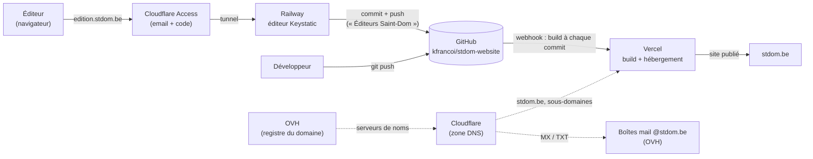

# Site de l'unité Saint-Dominique — stdom.be

Site web de l'unité Saint-Dominique : **67ème Guide** et **106ème Scout**.
Ce document est le point d'entrée pour toute personne qui reprend la gestion du site, qu'elle soit à l'aise avec le code ou non.

> ⚠️ **Mise en ligne pas encore terminée (état au 20/11/2026).** Le nouveau site est construit par Vercel à chaque modification, et l'éditeur fonctionne sur `edition.stdom.be`. Mais `stdom.be` et `www.stdom.be` pointent encore vers l'**ancien site**, hébergé chez OVH. Pour basculer, il faut créer dans Cloudflare les enregistrements DNS décrits en [section 8](#8-domaine-et-dns--ovh-et-cloudflare) et ajouter les domaines dans Vercel. Ce document décrit l'installation **cible**, une fois la bascule faite.

- [1. L'essentiel en 2 minutes](#1-lessentiel-en-2-minutes)
- [2. Architecture](#2-architecture)
- [3. Les comptes à connaître (et à transmettre)](#3-les-comptes-à-connaître-et-à-transmettre)
- [4. Modifier le contenu (sans code)](#4-modifier-le-contenu-sans-code)
- [5. Tâches courantes](#5-tâches-courantes)
- [6. Vercel : hébergement et déploiement](#6-vercel--hébergement-et-déploiement)
- [7. Railway : le serveur d'édition](#7-railway--le-serveur-dédition)
- [8. Domaine et DNS : OVH et Cloudflare](#8-domaine-et-dns--ovh-et-cloudflare)
- [9. Sous-domaines des sections](#9-sous-domaines-des-sections)
- [10. Développer en local](#10-développer-en-local)
- [11. Structure du dépôt](#11-structure-du-dépôt)
- [12. Dépannage](#12-dépannage)
- [13. Points d'attention et dette technique](#13-points-dattention-et-dette-technique)
- [14. Décisions d'architecture](#14-décisions-darchitecture)

---

## 1. L'essentiel en 2 minutes

| Question | Réponse |
|---|---|
| Où modifier un texte, un événement, un staff ? | `https://edition.stdom.be` (connexion par email + code reçu par email) |
| Où est le code ? | GitHub : `kfrancoi/stdom-website` (branche `main`) |
| Qui héberge le site public ? | **Vercel** (formule gratuite) |
| Qui héberge l'éditeur ? | **Railway** (formule payante, quelques dollars par mois : voir [section 7](#7-railway--le-serveur-dédition)) |
| Qui gère le nom de domaine `stdom.be` ? | **OVH** pour l'enregistrement du domaine et les boîtes mail ; **Cloudflare** pour le DNS et l'accès à l'éditeur |
| Combien de temps avant qu'une modification soit visible ? | Quelques minutes : la sauvegarde est publiée sur GitHub après 1 à 2 minutes, puis Vercel reconstruit le site |
| Faut-il un compte GitHub pour éditer ? | **Non.** Seuls les mainteneurs techniques en ont besoin |

Le principe : **le contenu est stocké sous forme de fichiers dans le dépôt GitHub**. Il n'y a pas de base de données. Keystatic est l'interface qui permet d'éditer ces fichiers depuis un navigateur. Elle tourne sur un petit serveur (Railway) qui publie chaque modification sur GitHub. Vercel reconstruit alors le site.

## 2. Architecture



### Deux hébergeurs, deux rôles

- **Vercel** sert le site public : des pages pré-générées, un CDN, l'optimisation des images. C'est gratuit, et le site est reconstruit à chaque commit sur `main`.
- **Railway** fait tourner l'éditeur. Keystatic y fonctionne en mode `local` : il lui faut un processus allumé en permanence, un disque où écrire les fichiers et une copie Git capable de pousser. Les fonctions de Vercel sont éphémères et n'offrent rien de tout cela.

Les séparer a un avantage : si l'éditeur tombe, le site public continue de fonctionner. Les raisons de ce choix sont détaillées en [section 14](#14-décisions-darchitecture).

### Les briques techniques

| Brique | Rôle |
|---|---|
| **[Astro](https://astro.build) 5** | Génère le site. Les pages publiques sont **pré-générées** (HTML statique) au moment du build |
| **Tailwind CSS 3** + `@tailwindcss/typography` | Mise en forme (couleurs de l'unité définies dans `tailwind.config.mjs`) |
| **[Keystatic](https://keystatic.com)** | Interface d'édition du contenu, servie par le serveur d'édition sur `edition.stdom.be` |
| **Markdoc** | Format des textes riches (histoire, chartes, grand camp…) |
| **`@astrojs/vercel`** | Adaptateur de déploiement Vercel (runtime Node 22) |

### Ce qui est statique, ce qui ne l'est pas

- **Statique** (HTML pré-généré, très rapide, rien à maintenir) : toutes les pages publiques — accueil, sections, calendrier, pratique, documents…
- **Serverless** (s'exécute à la demande sur Vercel) : uniquement l'admin `/keystatic` et son API `/api/keystatic`, un reste de l'ancien mode Keystatic Cloud qui n'est plus utilisé (voir [section 13](#13-points-dattention-et-dette-technique)). Les fonctions sont épinglées en région Paris (`cdg1`, dans `vercel.json`).
- **Images** : optimisées à la volée par Vercel (`/_vercel/image`, formats AVIF/WebP), configurées dans `astro.config.mjs`. Inutile de recompresser les photos à la main.

### Deux modes pour Keystatic

Défini dans `keystatic.config.ts` :

| Contexte | Mode | Comportement |
|---|---|---|
| `npm run dev` (ordinateur) | `local` | Édite directement les fichiers du dossier, **sans connexion** |
| Serveur d'édition (Railway, `edition.stdom.be`) | `local` | Même mode : le serveur fait tourner `astro dev`. Le script `editor/sync.sh` publie ensuite les fichiers modifiés (commit + push) |
| Build Vercel (`stdom.be/keystatic`) | `cloud` | Ancien mode Keystatic Cloud, **plus utilisé** depuis octobre 2026 |

Le site n'a besoin d'aucune variable d'environnement, ni sur Vercel ni en local. Le serveur d'édition a les siennes, décrites dans [`editor/README.md`](editor/README.md).

## 3. Les comptes à connaître (et à transmettre)

> ⚠️ **À compléter lors de la passation.** Ce tableau doit toujours indiquer qui détient réellement chaque accès. Un compte qui n'appartient qu'à une seule personne est un risque pour l'unité.

| Service | À quoi il sert | Adresse / projet | Titulaire(s) à ce jour |
|---|---|---|---|
| **GitHub** | Stocke le code **et** le contenu | `github.com/kfrancoi/stdom-website` | Kevin Françoisse — *à compléter : co-propriétaire ?* |
| **Vercel** | Build et hébergement du site public | *projet à compléter (nom exact dans le tableau de bord Vercel)* | *à compléter* |
| **Railway** | Serveur d'édition (Keystatic) | Projet `project-stdom`, service `stdom-website` ([railway.com](https://railway.com)) | Kevin Françoisse — *à compléter* |
| **Cloudflare** | DNS de `stdom.be`, tunnel et contrôle d'accès de l'éditeur (Zero Trust, équipe `misty-bar-1afc`) | [dash.cloudflare.com](https://dash.cloudflare.com) | *à compléter* |
| **OVH** | Enregistrement du domaine `stdom.be` + boîtes mail `@stdom.be` | [ovh.com/manager](https://www.ovh.com/manager) | *à compléter* |

**Recommandations pour la passation :**

1. Chaque service doit avoir **au moins deux personnes** en droits d'administration.
2. Sur GitHub : ajouter la personne en *collaborateur* (ou transférer le dépôt vers une organisation de l'unité).
3. Sur Vercel : inviter la personne dans l'équipe du projet (ou transférer le projet).
4. Sur Railway : inviter la personne dans le workspace (ou transférer le projet). **C'est le seul service payant** : le moyen de paiement doit être repris, sinon l'éditeur s'arrête.
5. Sur Cloudflare : ajouter la personne comme membre du compte. C'est là qu'on gère la liste des éditeurs (voir [Ajouter un éditeur](#ajouter-un-éditeur)).
6. Sur OVH : enregistrer un contact administratif/technique de secours pour le domaine. **Le renouvellement annuel du domaine est critique** : s'il expire, le site et les adresses mail disparaissent.

### Ce que ça coûte

| Service | Formule | Coût |
|---|---|---|
| Vercel | Gratuite (Hobby) | 0 |
| Railway | Payante | Environ 4 à 5 $ d'utilisation par mois (5,25 $ du 08/10 au 08/11/2026), presque entièrement en mémoire vive. Le montant total de l'abonnement est à vérifier sur la facture Railway |
| Cloudflare | Gratuite (DNS + Zero Trust) | 0 |
| GitHub | Gratuite | 0 |
| OVH | Domaine + mails | Renouvellement annuel, *montant à compléter* |

**Limite de dépense Railway** (Railway → Workspace → *Usage*, ou `railway usage limit status`) :
- à **5 $** d'utilisation dans le mois, une alerte est envoyée par email ;
- à **10 $**, Railway **arrête l'éditeur** jusqu'au début de la période de facturation suivante (le 8 du mois). C'est le minimum qu'accepte Railway pour un arrêt. Le site public n'est pas touché.

## 4. Modifier le contenu (sans code)

### Se connecter

1. Aller sur **`https://edition.stdom.be`** (l'éditeur s'ouvre directement)
2. Saisir son adresse email, puis le code reçu par email. La connexion reste valable une semaine
3. Modifier, puis cliquer sur **Save** (Enregistrer)
4. Attendre quelques minutes : la modification est publiée 1 à 2 minutes après la dernière sauvegarde, puis le site se reconstruit automatiquement

> Votre adresse email doit figurer dans la **liste des éditeurs autorisés** (voir [Ajouter un éditeur](#ajouter-un-éditeur)).

Tous les éditeurs travaillent sur la même copie du site. Toutes les modifications apparaissent sur GitHub sous le même auteur, « Éditeurs Saint-Dom ». Pour savoir qui s'est connecté et quand, consulter le journal de Cloudflare Access.

### Que modifier, et où ça apparaît

| Menu Keystatic | Contenu | Page du site |
|---|---|---|
| Actualités → **Infos flash** | Annonces affichées dans le visuel d'accueil (visibles sans défiler), avec date d'expiration | Accueil |
| Actualités → **Photos « La vie à Saint-Dom »** | Mosaïque de photos, la première en grand ; rubrique masquée tant qu'il n'y a pas de photo | Accueil |
| Unité → **Page L'Unité : logo & fédérations** | Logo « spirale » de la bannière ; nom, site web et logo des deux fédérations | `/unite` |
| Actualités → **Événements** | Calendrier de l'année | `/calendrier` + « Prochains événements » en accueil |
| Unité → **Staffs d'unité & ASBL** | Staff 67, staff 106, conseil d'administration ASBL | `/unite`, `/asbl`, `/contact` |
| Unité → **Histoire** | Texte riche | `/unite` |
| Unité → **Présence & engagement** | Texte riche | `/unite` |
| Sections → **67ème / 106ème** | Description, contacts, staff, visuel, photos de chaque section | `/sections` et `/sections/<unité>/<section>` |
| Pratique → **Inscriptions** | Case « ouvertes » + message d'information | `/pratique` |
| Pratique → **Grand camp / Uniformes** | Textes riches | `/pratique` |
| Pratique → **Cotisations & assurances** | Tableau des montants par unité et par section (montant vide = « À préciser »), textes cotisation, assurance et camp | `/pratique/cotisations` |
| Documents → **Téléchargements** | PDF à télécharger (fiche santé, autorisations, outils…). Catégories *Fiche santé*, *Autorisations* et *Droit à l'image* : rubrique « Documents à remplir », dans la colonne de l'unité choisie | `/documents` |
| Documents → **Chartes** | Les 3 chartes (scoutisme, totémisation, chef) | `/documents`, `/chartes/<nom>` |
| Documents → **Liens utiles** | Liens externes classés par catégorie | `/documents` |

### Ajouter un éditeur

Les éditeurs sont gérés dans Cloudflare, pas dans Keystatic : pas de compte à créer, une adresse email suffit.

1. Se connecter à Cloudflare avec un compte **administrateur**, puis ouvrir **Zero Trust**
2. *Access* → *Applications* → `edition.stdom.be` → règle (*policy*) **« Chefs »**
3. *Include* → *Emails* : ajouter l'adresse, puis enregistrer
4. La personne peut se connecter immédiatement sur `edition.stdom.be`

Pour retirer un éditeur, supprimer son adresse de la même liste.

> La formule gratuite de Cloudflare Zero Trust couvre jusqu'à **50 utilisateurs** (au moment de la mise en place). **Vérifier la grille tarifaire actuelle** avant d'en ajouter davantage.

## 5. Tâches courantes

### Mettre à jour le calendrier de l'année

*Keystatic → Actualités → Événements.* Un fichier par événement : titre, date (et dernier jour si l'événement dure plusieurs jours), catégorie, unité concernée (67, 106 ou les deux). Les événements passés se grisent automatiquement dans le calendrier ; ils n'ont pas besoin d'être supprimés.

### Ouvrir / fermer les inscriptions

*Keystatic → Pratique → Inscriptions.*

- Case **décochée** : les boutons d'inscription de la page Pratique sont grisés
- Case **cochée** : les boutons sont actifs
- Le champ *message* s'affiche au-dessus des boutons (vide = aucun message)

Les pages de section ne proposent pas d'e-mail d'inscription : leur bouton « S'inscrire » renvoie vers cette page (`/pratique#inscription`), qui est la même pour toutes les sections.

### Publier une info flash

*Keystatic → Actualités → Infos flash.* Renseigner un titre, un message, et idéalement **« Afficher jusqu'au »** pour que l'annonce disparaisse d'elle-même (voir l'[avertissement sur les dates](#les-contenus-dépendant-de-la-date-ne-se-rafraîchissent-quau-déploiement)).

### Ajouter un document à télécharger

*Keystatic → Documents → Téléchargements → Create.* Choisir la catégorie et envoyer le PDF. Il est publié dans `public/documents/`. Les catégories *Fiche santé*, *Autorisations* et *Droit à l'image* alimentent la rubrique « Documents à remplir » (menu Pratique), dans la colonne de l'unité choisie (« Les deux unités » : dans les deux colonnes).

### Mettre à jour les staffs (rentrée)

*Keystatic → Unité → Staffs d'unité & ASBL* pour les staffs d'unité et le CA de l'ASBL, et *Sections → [section] → Staff* pour les staffs de section. Les chefs d'unité de `/contact` sont retrouvés par **totem** : si le chef d'unité change, mettre aussi à jour `src/pages/contact.astro`, sinon le déploiement échoue (voir [Dépannage](#12-dépannage)).

### Ajouter une nouvelle section

1. *Keystatic → Sections → 67ème (ou 106ème) → Create.* Le **nom** de la section détermine son *slug* (l'adresse de la page, ex. `Les Amazones` → `amazones`). Renseigner type, description, contact, ordre d'affichage, staff, et le **visuel de thème** (envoyé dans `public/images/art_sections/`).
2. La page `/sections/<unité>/<slug>` est créée automatiquement.
3. **Étape manuelle, non automatique** — si on veut un sous-domaine `<slug>.stdom.be` : voir [section 9](#9-sous-domaines-des-sections).

### Changer un texte « en dur » (hors Keystatic)

Certains textes ne sont pas éditables via Keystatic car ils vivent directement dans le code des pages (`src/pages/*.astro`) : par exemple la FAQ et les étapes d'inscription dans `pratique.astro`, les projets de l'ASBL dans `asbl.astro`, ou les coordonnées du pied de page dans `Footer.astro`. Les modifier demande de toucher au code (voir [section 10](#10-développer-en-local)).

### Les contenus dépendant de la date ne se rafraîchissent qu'au déploiement

Les pages publiques sont générées **au moment du build**. Conséquence :

- la liste « **Prochains événements** » de l'accueil est calculée à la date du dernier build ;
- une **info flash** arrivée à expiration reste affichée tant que le site n'a pas été reconstruit ;
- le grisage des événements passés dans `/calendrier` suit le même principe.

Tant que quelqu'un édite régulièrement, tout est à jour. En période calme, **forcer un nouveau déploiement** : Vercel → projet → *Deployments* → menu `⋯` du dernier déploiement → **Redeploy**.
*(Amélioration possible : un « Deploy Hook » Vercel déclenché chaque nuit par un planificateur gratuit pour automatiser cela.)*

## 6. Vercel : hébergement et déploiement

### Principe

Le projet Vercel est connecté au dépôt GitHub. **Chaque commit sur `main` déclenche automatiquement un build et un déploiement en production.** Il n'y a aucune commande de déploiement à lancer.

| | |
|---|---|
| Framework détecté | Astro |
| Commande de build | `npm run build` (→ `astro build`) |
| Version de Node | 22.x |
| Région des fonctions | Paris (`cdg1`) — fichier `vercel.json` |
| Variables d'environnement | Aucune |

### Opérations courantes

- **Voir l'état d'un déploiement / les logs de build** : tableau de bord Vercel → projet → *Deployments*
- **Revenir à une version précédente** (en cas de problème) : *Deployments* → choisir un déploiement qui fonctionnait → `⋯` → **Promote to Production** (ou *Instant Rollback*). C'est immédiat et sans risque
- **Forcer un redéploiement** : *Deployments* → `⋯` → **Redeploy**
- **Gérer les domaines** : projet → *Settings* → *Domains*

### Chaque commit déploie

Que le commit vienne d'un développeur (`git push`) ou du serveur d'édition (« Éditeurs Saint-Dom »), le résultat est identique. Si un contenu mal formé casse le build, **l'ancienne version reste en ligne** : Vercel ne remplace la production que si le build réussit. L'erreur est visible dans les logs du déploiement.

> La formule gratuite de Vercel refuse de déployer un commit dont l'email d'auteur n'est pas rattaché au compte GitHub propriétaire du dépôt. Le serveur d'édition signe donc ses commits avec l'adresse « noreply » GitHub de ce compte (variable `GIT_AUTHOR_EMAIL`, voir [`editor/README.md`](editor/README.md)). **Si le dépôt change de propriétaire, il faut changer cette adresse.**

## 7. Railway : le serveur d'édition

### Principe

Railway fait tourner l'éditeur Keystatic dans un conteneur Docker ([`editor/Dockerfile`](editor/Dockerfile)). Le conteneur clone le dépôt, lance `astro dev` (Keystatic en mode `local`), puis publie les modifications des éditeurs. Il n'a aucune adresse publique : on y accède uniquement par `edition.stdom.be`, via un tunnel Cloudflare protégé par Cloudflare Access.

| | |
|---|---|
| Projet / service | `project-stdom` / `stdom-website`, région EU West |
| Branche déployée | `main` |
| Redéploiement | Seulement si `editor/**`, `package.json` ou `package-lock.json` changent (*Watch Paths*). Les commits de contenu ne redémarrent pas l'éditeur |
| Stockage | Volume `/data` : la copie du dépôt (110 Mo sur 500 Mo en novembre 2026) |
| Publication | `editor/sync.sh` vérifie toutes les 60 secondes. Dès que les fichiers n'ont plus bougé entre deux vérifications, il fait un commit et un push sur `main` avec une clé de déploiement GitHub |
| Variables | `GIT_DEPLOY_KEY`, `TUNNEL_TOKEN`, etc. : voir [`editor/README.md`](editor/README.md) |

Installation complète, variables et dépannage : [`editor/README.md`](editor/README.md).

### Pourquoi une formule payante

`astro dev` garde en mémoire les pages compilées. Mesures de novembre 2026 : environ **400 Mo au repos**, 600 à 700 Mo après des sessions d'édition, avec une pointe à **1,1 Go**. La mémoire représente presque toute la facture. La formule gratuite de Railway ne suffisait plus. Le stockage, lui, n'est pas en cause : le volume reste loin de sa limite. Coûts et limite de dépense : voir [Ce que ça coûte](#ce-que-ça-coûte).

### Opérations courantes

- **Voir les logs** (publication, erreurs) : Railway → service → *Deployments* → *View logs*, ou `railway logs`. Une publication réussie affiche `[sync] modifications publiées`
- **Redémarrer l'éditeur** : Railway → service → *Deployments* → `⋯` → **Restart**. Les modifications pas encore publiées sont conservées dans le volume
- **Suivre la consommation** : Railway → Workspace → *Usage*, ou `railway usage`
- **Ajouter ou retirer un éditeur** : cela ne se fait pas dans Railway mais dans Cloudflare (voir [Ajouter un éditeur](#ajouter-un-éditeur))

Si l'éditeur est arrêté (plantage, limite de dépense, panne Railway), **le site public n'est pas touché**. Seule l'édition est indisponible.

## 8. Domaine et DNS : OVH et Cloudflare

### Qui fait quoi

- **OVH** : enregistrement du nom de domaine `stdom.be` (renouvellement annuel) et **boîtes mail** `@stdom.be` (les enregistrements MX pointent vers `mx*.mail.ovh.net`). OVH héberge encore l'ancien site, jusqu'à la bascule vers Vercel (voir l'avertissement en haut de ce document).
- **Cloudflare** (formule gratuite) : **la zone DNS** depuis le 11/10/2026. Chez OVH, les serveurs de noms du domaine pointent vers Cloudflare (`elias` et `khloe.ns.cloudflare.com`). Cloudflare fournit aussi le tunnel et le contrôle d'accès de l'éditeur. Cloudflare Access ne protège que des domaines dont le DNS est chez Cloudflare : c'est ce qui a motivé le déménagement du DNS.

> ⚠️ **Ne résiliez pas l'hébergement OVH ni le domaine sans vérifier au préalable** que les adresses mail `@stdom.be` (administration67@, inscriptions106@, etc.) n'en dépendent pas.

### Enregistrements DNS

À gérer dans **Cloudflare → `stdom.be` → DNS → Records**. Les enregistrements Vercel sont à créer au moment de la bascule.

| Type | Nom | Valeur | Proxy Cloudflare | Rôle |
|---|---|---|---|---|
| `A` | `stdom.be` (racine) | `76.76.21.21` | Désactivé (*DNS only*) | Site principal sur Vercel |
| `CNAME` | `www` | `cname.vercel-dns.com` | Désactivé (*DNS only*) | `www.stdom.be` (redirigé vers `stdom.be`) |
| `CNAME` | `<section>` | `cname.vercel-dns.com` | Désactivé (*DNS only*) | Un par sous-domaine de section (voir [section 9](#9-sous-domaines-des-sections)) |
| `CNAME` | `edition` | *créé automatiquement par le tunnel* | **Activé** | Éditeur (ne pas modifier à la main) |

> **Les valeurs Vercel ci-dessus sont les valeurs standard.** Elles peuvent évoluer : en cas de doute, **la référence est toujours Vercel → projet → Settings → Domains**, qui affiche les enregistrements exacts à créer et indique si le domaine est correctement configuré. Garder le proxy Cloudflare **désactivé** sur les enregistrements Vercel : c'est Vercel qui gère le certificat HTTPS et le cache.

> ⚠️ **Ne supprimez ni ne modifiez jamais les enregistrements `MX`, `TXT` (SPF, DKIM, DMARC) ou `CNAME` liés au mail** : ils font fonctionner les adresses `@stdom.be`. Pour changer le site, on ne touche qu'aux enregistrements `A` de la racine et aux `CNAME` des sous-domaines.

### Vérifier que tout est en ordre

- Vercel → *Settings* → *Domains* : chaque domaine doit afficher **Valid Configuration**
- Le certificat HTTPS est délivré et renouvelé **automatiquement** par Vercel, il n'y a rien à faire
- Un changement DNS peut mettre de quelques minutes à quelques heures à se propager

### Renouvellement

Le nom de domaine se renouvelle **chaque année** chez OVH. Vérifier que le renouvellement automatique est activé et que les emails d'alerte d'OVH arrivent à une adresse **surveillée par plusieurs personnes**, pas à une boîte personnelle.

## 9. Sous-domaines des sections

Chaque section dispose d'une adresse courte `<slug>.stdom.be` (ex. `amazones.stdom.be`) qui **redirige** (HTTP 307) vers sa page : `https://stdom.be/sections/67eme/amazones`.

### Comment ça marche

Les règles se trouvent dans [`vercel.json`](vercel.json) : une règle par unité, qui repère le sous-domaine par une liste de noms séparés par `|` et redirige vers la bonne page.

```json
"value": "(?<section>amazones|durandal|eldorado|…)\\.stdom\\.be"
"destination": "https://stdom.be/sections/67eme/:section"
```

Sections actuellement déclarées :

- **67ème** : amazones, durandal, eldorado, farfadets, gavroches, himalaya, soleil-levant, tarentelle
- **106ème** : abeilles, aigles, chevalerie, clinfoc, dhak, merlin, mickey, rocher, serengeti

### Pourquoi pas un joker `*.stdom.be` ?

Un joker obligerait à déléguer toute la zone DNS à Vercel, donc à la sortir de Cloudflare. On perdrait alors l'accès protégé à l'éditeur, et on prendrait des risques pour les mails. Les sous-domaines sont donc déclarés **un par un**. C'est volontaire.

### ➕ Ajouter le sous-domaine d'une nouvelle section

Créer une section dans Keystatic **ne crée pas son sous-domaine**. Trois étapes :

1. **`vercel.json`** : ajouter le *slug* dans la liste de la bonne unité (règle 67ème ou 106ème), puis commit/push
2. **Vercel** → projet → *Settings* → *Domains* → **Add** → `<slug>.stdom.be`
3. **Cloudflare** → `stdom.be` → DNS → ajouter un `CNAME` : nom `<slug>`, valeur `cname.vercel-dns.com`, proxy **désactivé** (*DNS only*)

Si l'une des trois étapes manque, le sous-domaine ne fonctionne pas : sans l'étape 1 il n'y a pas de redirection, sans l'étape 2 Vercel refuse la requête, sans l'étape 3 l'adresse n'existe pas dans le DNS.

> Le *slug* dans `vercel.json` doit être **identique** au nom du fichier dans `src/content/sections67/` (ou `sections106/`), **en minuscules** : l'adresse de la page est toujours en minuscules, même si le fichier porte une majuscule (ex. `Amazones.json` → `/sections/67eme/amazones`).

## 10. Développer en local

Pour modifier le code, ou éditer le contenu depuis son ordinateur.

### Prérequis

- [Node.js](https://nodejs.org) **22** (la version utilisée par Vercel)
- Git, et un accès au dépôt GitHub

### Démarrage

```bash
git clone git@github.com:kfrancoi/stdom-website.git
cd stdom-website
npm install
npm run dev
```

| Adresse | Contenu |
|---|---|
| http://localhost:4321 | Le site |
| http://localhost:4321/keystatic | L'admin en **mode local** (sans connexion, écrit directement dans les fichiers) |

### Commandes

| Commande | Effet |
|---|---|
| `npm run dev` | Serveur de développement avec rechargement à chaud |
| `npm run build` | Construit le site comme sur Vercel (dans `dist/` et `.vercel/output/`) |
| `npm run preview` | Prévisualise le build |

**Avant de pousser un changement de code, lancer `npm run build`** : si le build échoue chez vous, il échouera chez Vercel (sans conséquence pour le site en ligne, mais le déploiement sera refusé).

### Workflow Git

- La branche de production est **`main`** : tout ce qui y arrive est publié
- Le serveur d'édition committe directement sur `main` (auteur « Éditeurs Saint-Dom ») : **toujours faire `git pull` avant de commencer à travailler**, sinon le `push` sera rejeté. Dans l'autre sens, le serveur récupère vos commits tout seul
- Un push qui modifie `editor/`, `package.json` ou `package-lock.json` redéploie aussi le serveur d'édition sur Railway. L'éditeur redémarre alors pendant quelques minutes
- Pour un changement de code important, préférer une branche + *pull request* : Vercel crée automatiquement un **déploiement de prévisualisation** (URL temporaire) pour la tester avant fusion
- Si vous éditez du contenu en local via `/keystatic`, il faut ensuite **committer et pousser** les fichiers modifiés

## 11. Structure du dépôt

```
.
├── editor/                  ← Serveur d'édition (Docker, déployé sur Railway) : voir editor/README.md
├── keystatic.config.ts      ← Définition de TOUT le contenu éditable (champs, collections, menus)
├── astro.config.mjs         ← Configuration Astro (intégrations, adaptateur Vercel, images)
├── vercel.json              ← Région des fonctions + redirections des sous-domaines
├── tailwind.config.mjs      ← Couleurs de l'unité et plugin typographie
├── package.json
│
├── src/
│   ├── content/             ← LE CONTENU (édité via Keystatic, un fichier par entrée)
│   │   ├── evenements/      ·  un fichier JSON par événement du calendrier
│   │   ├── sections67/      ·  une section 67ème par fichier
│   │   ├── sections106/     ·  une section 106ème par fichier
│   │   ├── flashs/          ·  infos flash
│   │   ├── documents/       ·  métadonnées des PDF à télécharger
│   │   ├── chartes/         ·  chartes (Markdoc)
│   │   ├── liens/           ·  liens utiles
│   │   ├── pages/           ·  textes riches (histoire, présence, grand camp, cotisations, uniformes)
│   │   ├── staffs.json      ·  staffs d'unité + conseil d'administration ASBL
│   │   └── inscriptions.json·  état des inscriptions + message
│   │
│   ├── lib/content.ts       ← Couche de lecture : transforme le contenu en données pour les pages
│   ├── pages/               ← Une page = un fichier (l'URL suit le nom du fichier)
│   ├── components/          ← Briques réutilisables (en-tête, pied de page, cartes…)
│   ├── layouts/             ← Squelette HTML commun
│   └── styles/global.css
│
└── public/                  ← Fichiers servis tels quels
    ├── documents/           ·  PDF à télécharger
    └── images/              ·  logo, hero, visuels de sections, images des textes riches
```

### Comment le contenu circule

```
keystatic.config.ts  ──définit──▶  src/content/*  ──lu par──▶  src/lib/content.ts  ──utilisé par──▶  src/pages/*.astro
   (le schéma)                      (les données)               (la couche de lecture)                 (l'affichage)
```

**Règle d'or : si on ajoute ou renomme un champ**, il faut modifier les **trois** : le schéma (`keystatic.config.ts`), la lecture (`src/lib/content.ts`) et la page qui l'affiche.

### Fichiers de contenu

Les noms de fichiers sont des *slugs* (minuscules, sans accent, tirets) — c'est eux qui forment les URL. Les fichiers JSON sont générés par Keystatic : on peut les éditer à la main, mais mieux vaut passer par l'interface pour éviter une erreur de format.

## 12. Dépannage

| Symptôme | Cause probable | Que faire |
|---|---|---|
| Je ne reçois pas de code, ou l'accès à `edition.stdom.be` est refusé | Adresse email absente de la liste des éditeurs | Un admin Cloudflare l'ajoute ([section 4](#ajouter-un-éditeur)) |
| `edition.stdom.be` affiche une erreur (502, page Cloudflare) | Éditeur arrêté sur Railway (plantage, limite de dépense) ou tunnel inactif | Railway → logs du service ; voir le dépannage de [`editor/README.md`](editor/README.md) |
| Ma modification n'apparaît pas | Pas encore publiée par le serveur d'édition, ou build Vercel pas terminé ou en échec | 1. Logs Railway : `[sync] modifications publiées` ? 2. Vercel → *Deployments* : état et logs du dernier déploiement |
| Le dernier déploiement est en erreur | Contenu ou code invalide | Lire le log. L'ancienne version reste en ligne ; corriger puis re-sauvegarder, ou annuler le dernier commit |
| « Prochains événements » ou une info flash périmée s'affichent encore | Pages figées au dernier build | **Redeploy** depuis Vercel ([détail](#les-contenus-dépendant-de-la-date-ne-se-rafraîchissent-quau-déploiement)) |
| Une image s'affiche cassée (404) | Image rangée dans un dossier non publié | Les images doivent se trouver dans `public/` ; ne pas les déplacer à la main |
| `git push` rejeté | Un éditeur a modifié le contenu depuis votre dernier `git pull` | `git pull --rebase` puis `git push` |
| `nouveau-slug.stdom.be` ne fonctionne pas | Une des 3 étapes manque | Reprendre la [procédure de la section 9](#-ajouter-le-sous-domaine-dune-nouvelle-section) |
| Le site ne répond plus du tout sur `stdom.be` | DNS modifié, domaine expiré ou problème Vercel | 1. [vercel-status.com](https://www.vercel-status.com) 2. Vercel → Domains (configuration valide ?) 3. Cloudflare : zone DNS inchangée ? 4. OVH : domaine renouvelé ? |
| Le déploiement échoue après un changement de chef d'unité (totem modifié ou staff réorganisé) | `contact.astro` retrouve les chefs d'unité **par totem** (`Tupaïa` côté 67, `Almiki` côté 106) ; si le totem n'existe plus dans le staff, le build plante (l'ancienne version reste en ligne) | Mettre à jour les deux totems en haut de `src/pages/contact.astro` |

### Annuler une mauvaise modification

- **Contenu ou code** : dans l'historique GitHub (`Commits`), ouvrir le mauvais commit → **Revert**. Vercel redéploie la version précédente
- **Urgence** : Vercel → *Deployments* → promouvoir un ancien déploiement (immédiat)

## 13. Points d'attention et dette technique

Constats faits lors de la rédaction de ce document, à traiter quand le temps le permet :

- **`/keystatic` sur Vercel est un reste de Keystatic Cloud.** En production, `keystatic.config.ts` configure toujours le mode `cloud`. L'admin `stdom.be/keystatic` passe donc encore par Keystatic Cloud, qui n'est plus utilisé depuis octobre 2026 : le dernier commit de `keystatic-cloud[bot]` date du 01/10/2026. Il faudrait désactiver cette porte d'entrée en double, puis supprimer le projet `saint-dom/stdom-website` sur keystatic.cloud.
- **`public/.htaccess` est obsolète.** Il date de l'ancien hébergement Apache chez OVH et n'est pas utilisé par Vercel. Il peut être supprimé sans risque.
- **`tsconfig.json` référence un alias `@data/*` → `src/data/*`**, dossier supprimé lors de la migration vers Keystatic. Sans effet, mais à nettoyer.
- **`tsx`** figure dans les dépendances de développement : c'était utile pour la migration initiale des données, plus nécessaire.
- **Textes en dur** (FAQ, étapes d'inscription, projets de l'ASBL, pied de page) : non éditables dans Keystatic. À migrer vers des collections si les non-développeurs doivent les maintenir.
- **Rafraîchissement par date** : voir [l'avertissement](#les-contenus-dépendant-de-la-date-ne-se-rafraîchissent-quau-déploiement) ; un redéploiement planifié résoudrait le problème.
- **Mises à jour de dépendances** : `npm audit` signale régulièrement des alertes. Sur un site statique leur impact est limité, mais prévoir une mise à jour annuelle (`npm update`, puis `npm run build`).
- **Fonctionnalités reportées** (décision de 2026, volontairement hors périmètre) : **newsletter** et **vente/dons d'uniformes (e-shop)**.
- **Visuels de section** : le champ s'appelle « Visuel de thème (en attendant le balzon) » — il est prévu de le remplacer par les vraies photos/illustrations des sections.

## 14. Décisions d'architecture

Pour comprendre *pourquoi* les choses sont ainsi, et éviter de défaire sans le savoir un choix réfléchi.

| Décision | Raison |
|---|---|
| **Contenu en fichiers dans Git, pas de base de données** | Rien à héberger ni à sauvegarder séparément ; historique complet et annulation gratuits ; le contenu et le code évoluent ensemble |
| **Keystatic** plutôt que Sanity, Payload ou Decap | Sanity : dépendance externe pour des données qui tiennent dans le dépôt. Payload : exige de faire tourner un serveur et une base de données. Decap : peu maintenu. Keystatic s'intègre nativement à Astro et stocke dans Git |
| **Éditeur auto-hébergé** (Keystatic en mode `local` sur Railway) plutôt que Keystatic Cloud (octobre 2026) | Une cinquantaine de chefs doivent pouvoir éditer **sans compte GitHub**. Keystatic Cloud n'est gratuit que jusqu'à 3 éditeurs ; l'éditeur auto-hébergé n'a pas de limite d'éditeurs |
| **Vercel pour le site, Railway pour l'éditeur** | Vercel ne peut pas faire tourner un processus permanent avec un disque et une copie Git, dont l'éditeur a besoin. Tout mettre sur Railway ferait perdre le CDN et l'optimisation d'images de Vercel, et lierait le site public au sort de l'éditeur |
| **Accès à l'éditeur par Cloudflare Access** (email + code) | Aucun mot de passe à gérer, aucune adresse publique pour l'éditeur, journal des connexions. Gratuit jusqu'à 50 utilisateurs |
| **Vercel** plutôt que l'hébergement mutualisé OVH | L'hébergement mutualisé ne peut pas exécuter Node.js (admin Keystatic) ni rebuilder à chaque commit |
| **OVH conservé pour le domaine et les mails, DNS chez Cloudflare** | Le domaine et les boîtes mail sont chez OVH. Le DNS a été déplacé chez Cloudflare, car Cloudflare Access ne protège que des domaines dont il gère le DNS |
| **Sous-domaines des sections = redirections 307**, déclarés un par un | Une réécriture dupliquerait tout le site sous 17 hôtes (mauvais pour le référencement) ; un joker `*.stdom.be` imposerait de déplacer le DNS chez Vercel |
| **Pages pré-générées** (statiques) | Vitesse, coût nul, aucune maintenance serveur. Contrepartie : les contenus liés à la date se figent entre deux builds |
